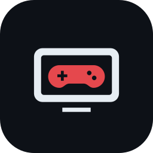
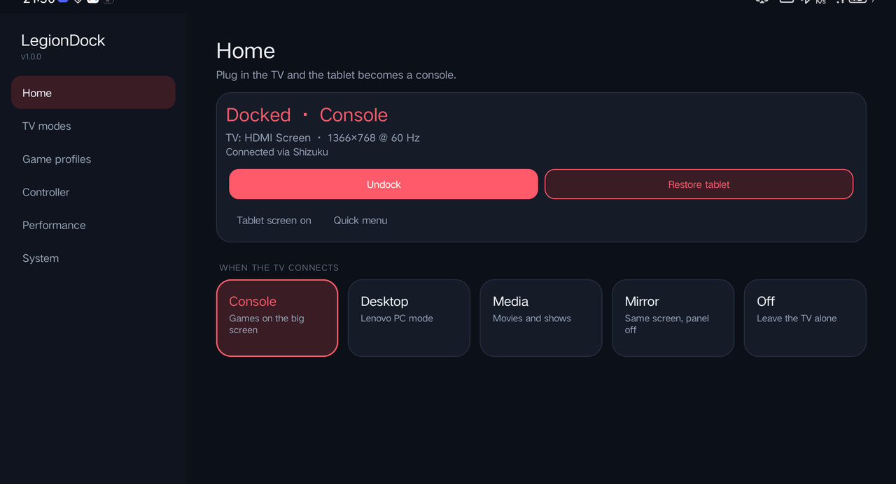
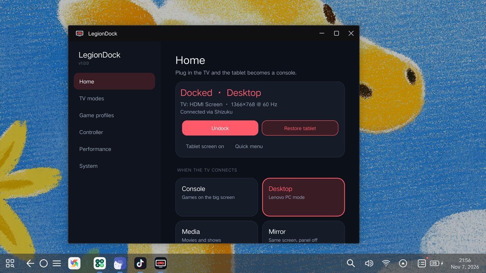
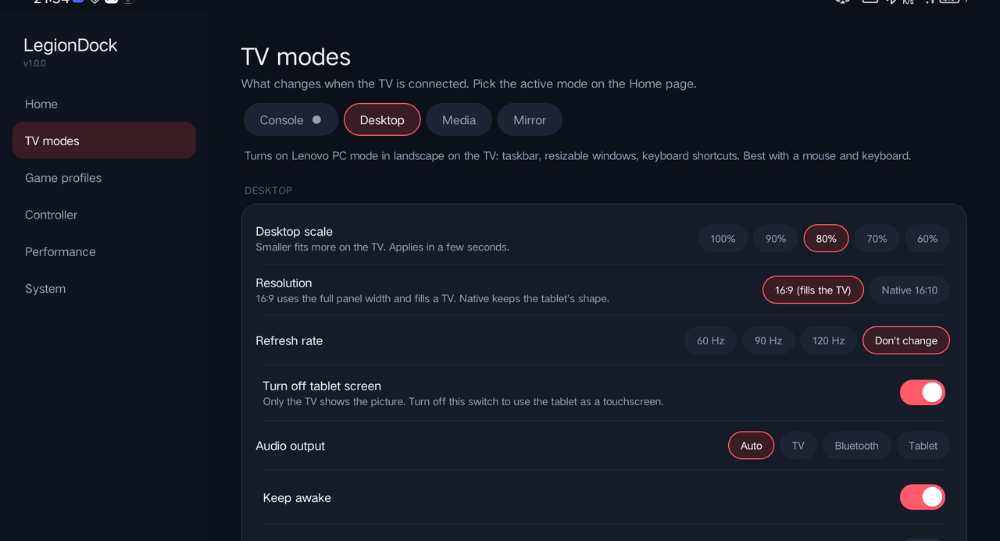
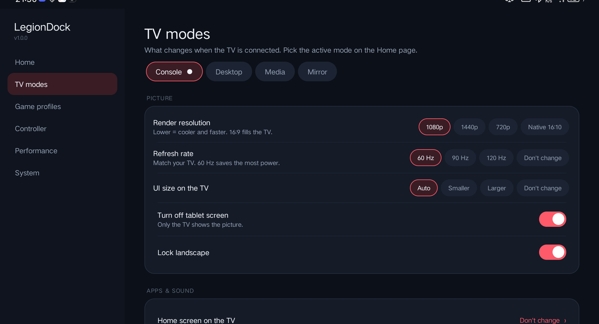
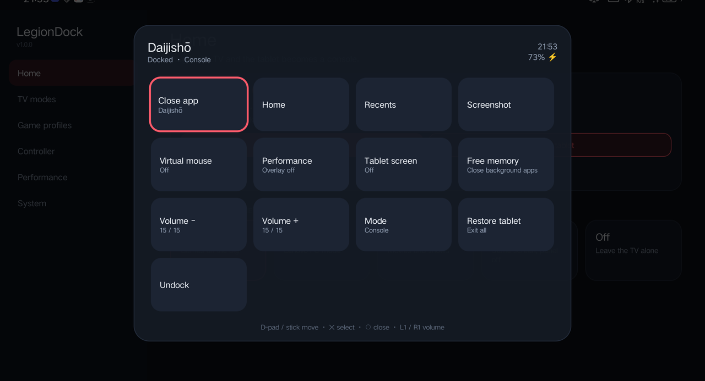

<div align="center">



# LegionDock

[](https://github.com/ttabouch12/LegionDock/actions/workflows/build.yml)
[](https://github.com/ttabouch12/LegionDock/releases/latest)
[](LICENSE)

**Plug your Lenovo Legion tablet into a TV and it becomes a console.**

The tablet screen turns off, the picture goes to the TV in landscape, your controller drives everything,
and when you unplug, the tablet goes back exactly how it was.

[**Download the latest APK**](https://github.com/ttabouch12/LegionDock/releases/latest) ·
[Setup guide](docs/SETUP.md) ·
[Features](docs/FEATURES.md) ·
[Troubleshooting](docs/TROUBLESHOOTING.md)



</div>

---

## What it does

| | |
|---|---|
| 🎮 **Console mode** | Landscape 1080p on the TV, tablet screen off, your game launcher as the home screen, controller-friendly everything. |
| 🖥️ **Desktop mode** | Turns on Lenovo's PC mode on the TV (taskbar and windows) for mouse and keyboard, with an adjustable scale. |
| 🎬 **Media mode** | Movies and shows on the TV with the tablet screen off. |
| 🪞 **Mirror mode** | The tablet's own picture on the TV, with the tablet panel off and nothing else changed. |
| ↩️ **Automatic undo** | Unplug the TV and everything LegionDock changed (resolution, UI size, refresh rate, rotation, audio) is put back. |
| 🕹️ **Controller tools** | Guide/PS/Xbox button opens a quick menu, a virtual mouse on the left stick, and handheld mode for clip-on controllers. |
| ⚡ **Game profiles** | Per-game refresh rate, FPS limit, performance overlay and memory cleanup, applied automatically when the game opens. |
| 🔋 **Battery care** | Bypass charging while docked (runs from the charger, not the battery). |
| 💾 **Switch save sync** | Keeps Eden and Citron saves in sync, newest save wins, with automatic backups. |

No root needed. LegionDock uses [Shizuku](https://shizuku.rikka.app/) for the system switches (root works too).

## Screenshots

<table>
<tr>
<td align="center"><br><sub>Desktop mode (Lenovo PC mode) on the TV</sub></td>
<td align="center"><br><sub>Desktop settings: scale, resolution, screen</sub></td>
</tr>
<tr>
<td align="center"><br><sub>Each mode has its own settings</sub></td>
<td align="center"><br><sub>Quick menu: hold the Guide button</sub></td>
</tr>
</table>

## Quick start

1. **Install** [Shizuku](https://shizuku.rikka.app/download/) and start it ([how](docs/SETUP.md#2-start-shizuku)).
2. **Install** `LegionDock-x.y.z.apk` from [Releases](https://github.com/ttabouch12/LegionDock/releases/latest).
3. **Open LegionDock**, tap **Finish setup** and follow the two steps (allow Shizuku, turn on the controller service).
4. **Pick a mode** under *When the TV connects*, then plug in the TV. That's it.

Full walkthrough with pictures: **[docs/SETUP.md](docs/SETUP.md)**.

## Supported tablets

LegionDock is made for **Lenovo Legion tablets on ZUI / ZUXOS, Android 11 or newer**:

| Tablet | Status |
|---|---|
| Legion Y700 Gen 3 (TB321FU, 2024) | ✅ Developed and tested on this one (ZUXOS 1.5, Android 16) |
| Legion Y700 Gen 4 (TB322FC, 2025) | 🟡 Should work. Please report! |
| Legion Y700 Gen 2 (TB320FC, 2023) / Legion Tab | 🟡 Should work. Please report! |
| Legion Y700 Gen 1 (TB-9707F) | 🟡 Should work on Android 11+. Please report! |
| Other Android tablets | 🟠 Console, Media and Mirror modes mostly work; Desktop mode and bypass charging are Lenovo-only and hidden automatically |

LegionDock checks what your tablet supports when it starts, and hides features it doesn't have.
If you try it on another model, [open an issue](https://github.com/ttabouch12/LegionDock/issues/new) and say how it went.

## If something goes wrong

- Press **Restore tablet** on the Home page. It undoes every change LegionDock made.
- Can't reach the app? Unplug the TV: LegionDock restores the tablet automatically.
- Still stuck? Run the [rescue script](tools/rescue.sh) from a computer:
  ```
  adb push tools/rescue.sh /data/local/tmp/
  adb shell sh /data/local/tmp/rescue.sh
  ```

More in **[docs/TROUBLESHOOTING.md](docs/TROUBLESHOOTING.md)**.

## How it works

LegionDock is a small Android app (plain Java, no libraries) with a shell backend.
It talks to Shizuku directly over its binder protocol, runs [`core.sh`](app/src/main/assets/core.sh) as the shell user, and
saves every setting it changes so it can put them back. The full tour is in **[docs/HOW-IT-WORKS.md](docs/HOW-IT-WORKS.md)**.

## Building

```
gradle :app:assembleRelease     # Gradle 8.13+, JDK 17, Android SDK 36
```

Or just push a commit: GitHub Actions builds an APK for every push. See [CONTRIBUTING.md](CONTRIBUTING.md).

## Credits

- **[Shizuku](https://github.com/RikkaApps/Shizuku)** by RikkaApps (Apache-2.0): LegionDock talks to Shizuku's binder protocol directly.
  [`BinderContainer`](app/src/main/java/moe/shizuku/api/BinderContainer.java) re-creates the class name and parcel layout of Shizuku's API so the binder can be received; no Shizuku code is copied.
- **Lenovo ZUI / ZUXOS**: the PC-mode switch, bypass-charging setting and display quirks were found by studying the tablet's own firmware and settings. Not affiliated with Lenovo.
- Works great with **[Daijishō](https://play.google.com/store/apps/details?id=com.magneticchen.daijishou)**, **[Eden](https://eden-emu.dev)** and **[Citron](https://github.com/citron-neo/emulator)**, which are separate projects and are not included.
- GPL-3.0 license text from the [GNU project](https://www.gnu.org/licenses/gpl-3.0.html).

## License

[GPL-3.0](LICENSE). LegionDock is an independent project and is not affiliated with or endorsed by Lenovo.
"Legion" is a trademark of Lenovo.
