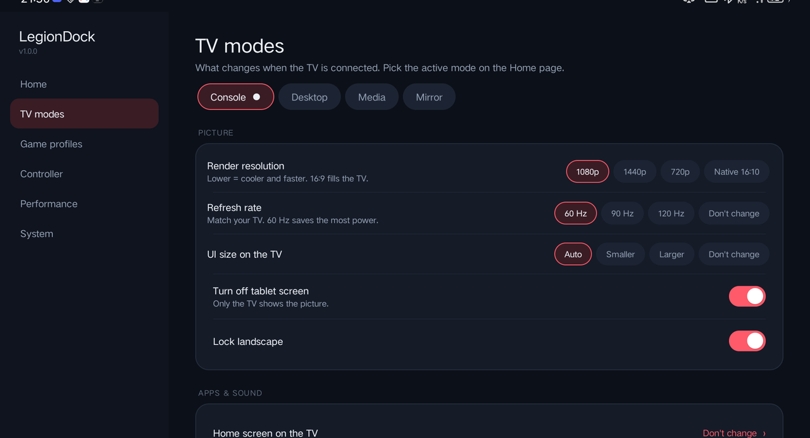
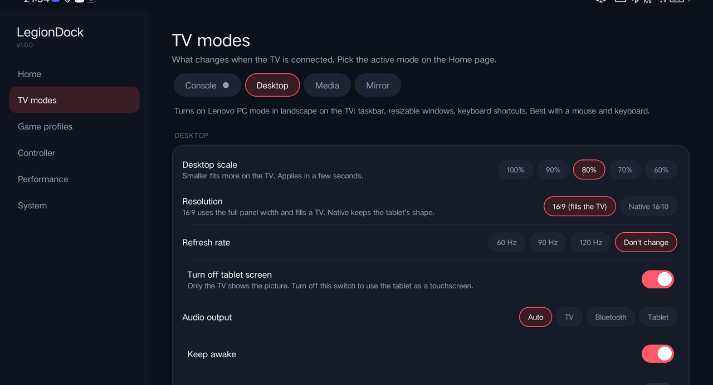
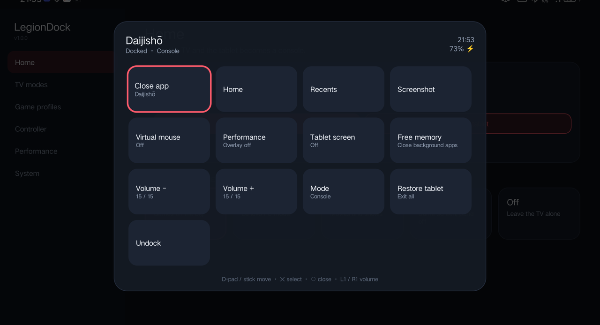

# Features

## TV modes

When the TV is connected, LegionDock applies the mode you picked on the Home page. Each mode has its own settings under **TV modes**.

### Console
For games and emulators with a controller.
- **Render resolution**: 1080p, 1440p, 720p or native 16:10. Lower runs cooler and faster; 16:9 fills the TV.
- **Refresh rate**: 60/90/120 Hz, or don't change. 60 Hz matches most TVs and saves power.
- **UI size on the TV**: makes menus readable from the couch.
- **Turn off tablet screen**: only the TV shows the picture.
- **Lock landscape**: the TV always gets a landscape picture, even if the tablet lies flat.
- **Home screen on the TV**: use your favourite launcher (Daijishō, ES-DE, …) while docked; your normal launcher comes back afterwards.
- **Open automatically**: start an app right after docking.
- **Audio output**: Auto, TV (HDMI), Bluetooth or tablet speakers.
- **Do Not Disturb**, **Keep awake**, **Faster animations**, **Free memory when docking**.

### Desktop
Turns on Lenovo's **PC mode** (taskbar, resizable windows, keyboard shortcuts), in landscape on the TV.

- **Desktop scale** (100 / 90 / 80 / 70 / 60 %). Smaller fits more on the screen. It changes live, in a few seconds.
- **Resolution**: 16:9 at the panel's full width (fills the TV), or native 16:10.
- **Turn off tablet screen**: on by default. Turn it off to use the tablet as a touchscreen next to the TV.

Desktop mode needs Lenovo's PC mode (ZUI / ZUXOS). On other tablets the mode is hidden.

> Lenovo's PC mode only mirrors (it can't be a separate second screen), so the tablet and the TV show the same desktop.
> Maximised windows hide their title bar until the pointer reaches the top edge; that is Lenovo's design.

### Media
Tuned for video: tablet screen off, audio to the TV, Do Not Disturb.

### Mirror
The tablet's normal picture on the TV with the tablet panel off. Resolution, UI size and orientation are left alone.

### Power & connections (every mode)
- **Turn on Bluetooth** when docking, so your controller connects right away.
- **Bypass charging**: while docked and charging, the tablet runs from the charger instead of cycling the battery (Lenovo tablets only).
- **Turn off touch vibration** while docked.

## Automatic undo

Before changing anything, LegionDock saves the original value. On undock (or when you unplug the TV) it puts back **exactly** what was there:
resolution, UI size, refresh rate, rotation and auto-rotate, animations, screen timeout, Do Not Disturb, audio route, home screen, Bluetooth, bypass charging, touch vibration and PC mode.

It remembers which values it set itself, so a crash or a forced reboot in the middle of docking can't make TV settings "stick" as your normal ones.

**Restore tablet** on the Home page runs the same undo on demand and keeps the tablet in tablet mode until you unplug the TV.

## Controller

- **Guide button** (PS / Xbox / Home): tap = home screen, hold = **quick menu**.
- **Select + Start**: also opens the quick menu, for controllers without a Guide button.
- **Quick menu**: dock / undock, tablet screen on/off, virtual mouse, performance overlay, close the current app, free memory, recents, screenshot, volume, and Restore tablet. Works fully with the D-pad.
- **Virtual mouse**: the left stick moves a cursor, ✕/A taps (hold for long-press), ○/B goes back, the right stick scrolls. Turn it on per mode, per game, from the quick menu, or with a button combo (**Share + L3** by default).
- **Handheld mode**: applies its own settings when your clip-on / telescopic controller connects and no TV is plugged in (for example 60 Hz, overlay on, Do Not Disturb).

## Game profiles

Pick an app (game, emulator, launcher) and set what happens while it is in front:

- refresh rate (match 50/60 Hz games, or go higher for smooth Android games)
- FPS limit (experimental; uses Android's game mode)
- virtual mouse and performance overlay on/off
- free memory when it launches

Profiles apply on the tablet and on the TV, and switch back automatically when you leave the app.

## Performance overlay

A small strip over your game with FPS, CPU / GPU temperature and load, and battery power in watts.
Turn it on per mode, per game, in handheld mode or from the quick menu.

## Switch save sync (Eden ↔ Citron)

If you use both the **Eden** and **Citron** Switch emulators, LegionDock keeps their saves in sync:

- When you leave either emulator, the newest save of each game is copied to the other one a few seconds later.
- A backup snapshot is taken first, in `Games/Saves-Backup` (the 5 most recent are kept).
- If an emulator is still open, its saves are left alone until the next sync.
- **System → Switch saves** has the on/off switch and a **Sync now** button.

## System

- **Memory cleanup**: apps to force-stop when cleanup runs (background apps are always trimmed).
- **Force mirror mode on the TV**: stops Lenovo's external desktop mode from taking over the TV while docked.
- **Start after reboot**, **Turn Bluetooth off after undocking**.
- **Reset display size & rotation**: puts UI size, resolution, animations and auto-rotate back to tablet defaults.
- **Reset LegionDock to default**: restores the tablet, then erases all settings.
- **Diagnostics**: a report you can copy into a bug report.
