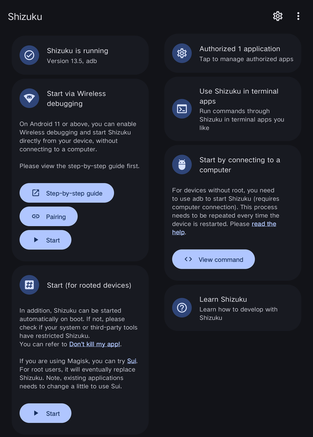
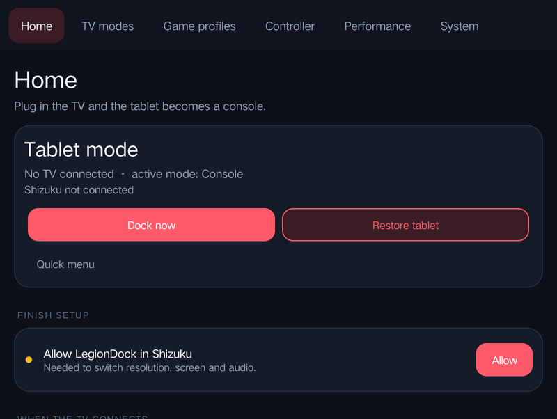
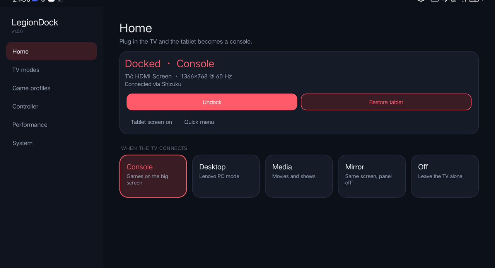

# Setup guide

This takes about 5 minutes. You only do it once.

**You need:** a Lenovo Legion tablet on Android 11 or newer, a USB-C to HDMI adapter or dock (the tablet's side port supports video out), and ideally a Bluetooth controller.

---

## 1. Install Shizuku

LegionDock changes system settings (screen resolution, refresh rate, turning the panel off). Android only allows that from the "shell" user, and [Shizuku](https://shizuku.rikka.app/) gives apps that access without rooting the tablet.

Download Shizuku from [Google Play](https://play.google.com/store/apps/details?id=moe.shizuku.privileged.api) or [GitHub](https://github.com/RikkaApps/Shizuku/releases).

> Rooted? You can skip Shizuku: LegionDock uses root automatically when it has it.

## 2. Start Shizuku

1. Turn on **Developer options**: *Settings → About tablet*, tap **Software version** (or **Build number**) 7 times.
2. In *Settings → System → Developer options*, turn on **Wireless debugging**.
3. Open Shizuku → **Start via Wireless debugging** → **Pairing**, and follow its steps (it pairs through a notification).
4. Tap **Start**. Shizuku should say *"Shizuku is running"*.

> After a reboot, open Shizuku and tap **Start** again (Wi-Fi must be on). This is how Shizuku works without root.

## 3. Install LegionDock

Download `LegionDock-x.y.z.apk` from the [latest release](https://github.com/ttabouch12/LegionDock/releases/latest) and open it. Allow "install unknown apps" for your browser or file manager if Android asks.

## 4. Finish setup in the app

Open LegionDock. The Home page shows a **Finish setup** card with what's left:

1. **Allow LegionDock in Shizuku.** Tap it and press **Allow** in the Shizuku popup.
2. **Turn on the controller service.** This opens *Settings → Accessibility*. Open **LegionDock controller service** and turn it on.
   It powers the Guide button, the quick menu, the virtual mouse and per-game profiles. It never reads what's on screen.
3. Allow notifications and "no battery restrictions" if asked, so LegionDock can keep running in the background.

On some Lenovo firmware you may also get a popup asking to let LegionDock "get the installed apps list". Allow it: the app picker in Game profiles needs it.

## 5. Pick what happens when the TV connects

On the Home page, under **When the TV connects**, choose a mode:

| Mode | Best for |
|---|---|
| **Console** | Games and emulators with a controller |
| **Desktop** | Mouse and keyboard, apps in windows (Lenovo PC mode) |
| **Media** | Movies and shows |
| **Mirror** | The tablet's picture as-is on the TV, tablet panel off |
| **Off** | Do nothing when the TV is plugged in |

Each mode's options are under **TV modes** (resolution, refresh rate, home screen app, audio output, Bluetooth, and more).

## 6. Plug in the TV

Connect the tablet to the TV. LegionDock switches to your mode within a couple of seconds, with a short transition screen.
Unplug, and the tablet goes back to normal.

You can also dock and undock by hand with the **Dock now / Undock** button.

---

### Tips

- **Pair your controller first** (or turn on *Turn on Bluetooth* in the mode settings) so it's ready when the TV comes on.
- **Choose a home screen for the TV** in *TV modes → Console → Home screen on the TV*, for example Daijishō, ES-DE or Beacon.
- **Hold the Guide / PS / Xbox button** for the quick menu: switch modes, toggle the mouse, show the performance overlay, close the game.
- **No Guide button?** Press **Select + Start** together.

Next: [everything LegionDock can do](FEATURES.md).
